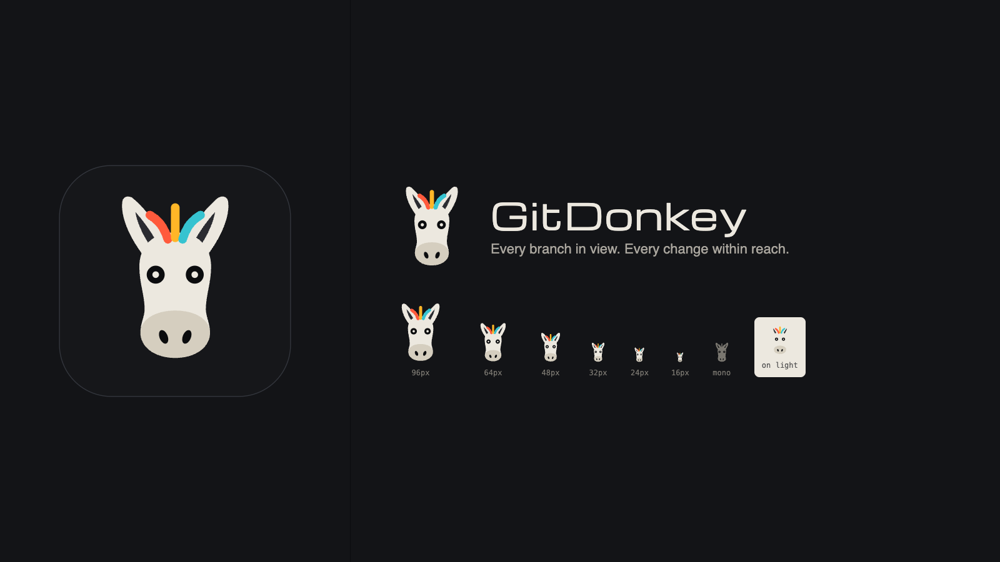

# GitDonkey

A free, open-source desktop Git client for macOS and Windows, built with Electron and plain
HTML/CSS/JS. The familiar three-pane layout of graphical Git clients (if you have used
GitKraken, you already know your way around) with its own identity: a patched modular rig
where branches are cables, commits are jacks, and merging is patching one branch into another.



## Download

Free and open source. Grab the latest build from [Releases](https://github.com/NathanCart/gitdonkey/releases/latest):

| Platform | File |
| --- | --- |
| macOS, Apple Silicon | `GitDonkey-<version>-mac-arm64.dmg` |
| macOS, Intel | `GitDonkey-<version>-mac-x64.dmg` |
| Windows 10/11, x64 | `GitDonkey-Setup-<version>-x64.exe` |

GitDonkey drives the Git you already have, so install Git first ([Git for Windows](https://git-scm.com/download/win); on macOS run `xcode-select --install`).

The builds are not code-signed yet, so the first launch needs one extra click:

- **macOS**: open the app once, then go to System Settings → Privacy & Security and click **Open Anyway**.
- **Windows**: on the SmartScreen prompt click **More info** → **Run anyway**.

## Updates

GitDonkey looks for a new release on GitHub when it starts and every six hours. When there is one, a card shows the new version and its release notes, with **Update**, **Later** and **Skip this version**; after **Later**, a key on the status strip brings the card back. **Check for Updates…** (in the GitDonkey menu on macOS, the Help menu on Windows) checks straight away, even for a version you skipped, and Settings has a switch to stop the automatic checks. A check is one anonymous request to the GitHub API; nothing about you or your repositories is sent.

**Update** downloads the build for your computer and checks it against the SHA-256 checksum GitHub publishes for the release. Then:

- **macOS**: **Restart to update** swaps the new GitDonkey.app in for the old one and reopens it. GitDonkey downloads the update itself rather than through a browser, so the new version carries no quarantine flag and there is no **Open Anyway** step this time. If GitDonkey can't write to the folder it lives in (a standard, non-admin account with GitDonkey in Applications, say), it opens the disk image instead so you can drag it to Applications.
- **Windows**: **Restart to update** runs the installer silently over your current install, and GitDonkey starts again when it's done.
- **Anything else**, or a computer with no build in the release: **Download** opens the release page.

The builds aren't code-signed, which rules out the usual Squirrel / electron-updater route on macOS; this is why GitDonkey installs its own updates.

## Signing in to remotes

When a remote needs a login, GitDonkey asks for it in its own dialog: username and token for HTTPS, passphrase for SSH keys, and a fingerprint check for new SSH hosts. Git then saves the login in your system keychain (macOS Keychain, Windows Credential Manager), so you are only asked once. If the [GitHub CLI](https://cli.github.com/) is installed and logged in (`gh auth login`), GitHub remotes sign in automatically.

## Themes

**Themes…** (in the GitDonkey menu on macOS, the File menu on Windows, or Settings) has 21 built-in themes: GitDonkey's own Patch Bay, Studio Paper, Eurorack Silver, Hay Bale, Oscilloscope, Amber CRT, Tape Deck, Neon Arcade, Deep Sea and High Contrast, plus Nord, Dracula, Solarized, Gruvbox, Monokai, Catppuccin, Tokyo Night and Rosé Pine. Click one and the whole window changes, graph lanes included.

**New theme…** opens the theme builder beside the window, so you see every change on the real app as you make it. Each of the 24 colours has a picker and a hex field; **Shades from Case + Legend** works out the panels, rules and text shades from your background and text colours; and a readability check lists any text or cable that's too faint, with **Fix readability** to nudge just those colours until they pass (WCAG AA for text, 3:1 for cables).

If you've set up AI commit messages, describe a theme (“sunset”, “forest at dawn”, “1980s arcade”) and press **Generate**: the same provider and key design all 24 colours, GitDonkey fixes anything unreadable, and you tweak and save. Only your description is sent.

**Copy theme code** gives you a short bit of text to share; anyone can paste it into **Themes → Import…**.

## AI commit messages

Optional, and off until you set it up. Press **Generate** in the commit box (or open **AI Commit Messages…** from the GitDonkey menu, or Settings) and pick a provider:

- **OpenAI**, **Anthropic**, **OpenRouter** or **Google Gemini**, with your own API key
- **Ollama**, running on your own computer, with no key
- **Any OpenAI-compatible endpoint** (LM Studio, vLLM, a company gateway): give its base URL, and a key if it needs one

**Check key and load models** tests the key and lists the provider's models; leave Model empty to use the default. You can add your own instructions, like “use Conventional Commits”, and it follows the style of your recent commits anyway.

What is sent, and when: only when you press Generate, GitDonkey sends the staged diff (lockfiles and binaries left out, long files trimmed), the file names, the branch name and your last few commit subjects to the provider you chose. Nothing else, and nothing at any other time. API keys are encrypted with your system keychain (Electron `safeStorage`), stay in the main process, and are only ever sent to their own provider. The message lands in the summary and description for you to read and edit before committing.

## Run from source

```bash
npm install
npm start                      # opens the welcome screen
npx electron . /path/to/repo   # opens a repository directly
```

Release builds:

```bash
npm run dist:mac   # dist/release/*.dmg (Apple Silicon + Intel)
npm run dist:win   # dist/release/GitDonkey-Setup-*.exe
npm run brand      # regenerate the icon, logo and brand sheet
```

## What it does

- **Commit graph** of every branch, remote branch and tag, with a WIP row, colour-coded lanes, branch/tag plugs, infinite loading and find (message, author, SHA).
- **Staging** by file, hunk or single line, plus discard (file, hunk, lines) and discard-all. Path and tree views, multi-select.
- **Commit** with summary/description, amend, or message-only amend (⌘↵ to commit).
- **AI commit messages** (optional): write the message from the staged changes with OpenAI, Anthropic, OpenRouter, Gemini, Ollama or any OpenAI-compatible endpoint, using your own key.
- **Diffs** in unified or split view, hunks-only or full file, ignore-whitespace, syntax highlighting, and side-by-side image diffs. Also file view, file history (follows renames) and blame.
- **Branches**: create, check out (local, remote-tracking, detached), rename, delete, set upstream, fast-forward, merge, rebase, cherry-pick, revert, and reset soft/mixed/hard.
- **Drag to patch**: drag one branch onto another to merge, rebase, fast-forward or push.
- **Interactive rebase**: reorder, pick, reword, squash, fixup or drop.
- **Conflicts**: per-conflict ours/theirs/both, take a whole side, edit the output by hand, then continue, skip or abort a merge, rebase, cherry-pick or revert.
- **Remotes**: fetch (manual or automatic), pull (merge / fast-forward only / rebase), push with upstream setup, a pull-or-force choice on rejection (`--force-with-lease`), add/edit/remove remotes, and delete remote branches and tags.
- **Stashes** (including untracked files) and **tags** (lightweight or annotated, push, delete).
- **Undo / redo** for commits, checkouts, branch create/delete/rename, resets, tags and interactive rebases.
- **Author avatars** from GitHub and Gravatar (switch off in Settings).
- **Tabs** for multiple repositories, recent repositories, clone, init, drag a folder in to open it, and auto-refresh when files change.
- **Themes**: 21 built in, a live theme builder with a readability check, AI-designed themes from a description, and shareable theme codes.
- **Updates**: a notice when a new release is out, with its notes, and a one-click download and restart (switch off in Settings).

## Keyboard

On Windows, read Ctrl for ⌘, Alt for ⌥ and Shift for ⇧.

| Action | Keys |
| --- | --- |
| Open / clone / new repository | ⌘O / ⇧⌘N / ⌥⌘N |
| New tab / close tab | ⌘T / ⌘W |
| Find commits / filter branches | ⌘F / ⌥⌘F |
| Fetch / pull / push | ⇧⌘F / ⇧⌘L / ⇧⌘P |
| Create branch | ⌘B |
| Stash / pop | ⌥⌘S / ⌥⌘P |
| Stage all / unstage all | ⇧⌘S / ⇧⌘U |
| Commit | ⌘↵ in the message box |
| Undo / redo Git action | ⌘Z / ⇧⌘Z (outside text fields) |
| Move through commits | ↑ ↓ or J K |
| Toggle sidebar / commit panel | ⌘J / ⌘K |

## Tests

```bash
npm test          # unit tests against real temporary repositories (backend, graph, patches, conflicts, avatars, sign-in, updates, themes)
npm run test:e2e  # Playwright run of the real app against a demo repo and a bare "origin", then the update flow against a fake release feed, then themes (with a fake AI endpoint)
```

The update run serves a release one major version ahead from 127.0.0.1. On macOS it goes on to download a real DMG, swap a stand-in app bundle and reopen it; that last check builds a tiny launcher with `cc` from the Xcode Command Line Tools and is skipped without them.

The end-to-end run writes screenshots to `test/e2e/shots/`.

## Layout

```
src/main/       Electron main process: git.js (all Git operations), ai.js (AI commit messages, key vault), IPC, menus, file watcher, settings
src/preload/    the allow-listed bridge between main and renderer
src/renderer/   the UI (ES modules, no build step)
  lib/          pure logic: graph lanes, diff parsing / partial patches, conflict parsing, logo mark
scripts/        build-brand.js renders the icon, logo and brand sheet (npm run brand)
test/           unit and end-to-end suites
```

## Contributing

Issues and pull requests are welcome. Please run `npm test` and `npm run test:e2e` before opening a PR; the end-to-end suite writes screenshots to `test/e2e/shots/` that are handy to attach.

## License

[MIT](LICENSE). Bundled fonts, icons and libraries keep their own licenses; see [THIRD_PARTY_NOTICES.md](THIRD_PARTY_NOTICES.md).
